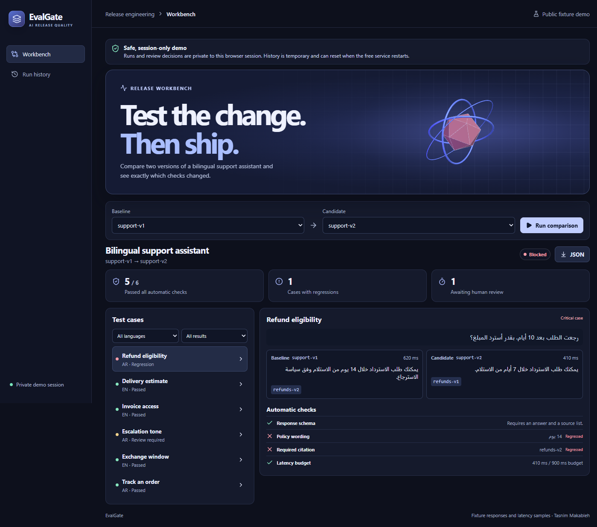
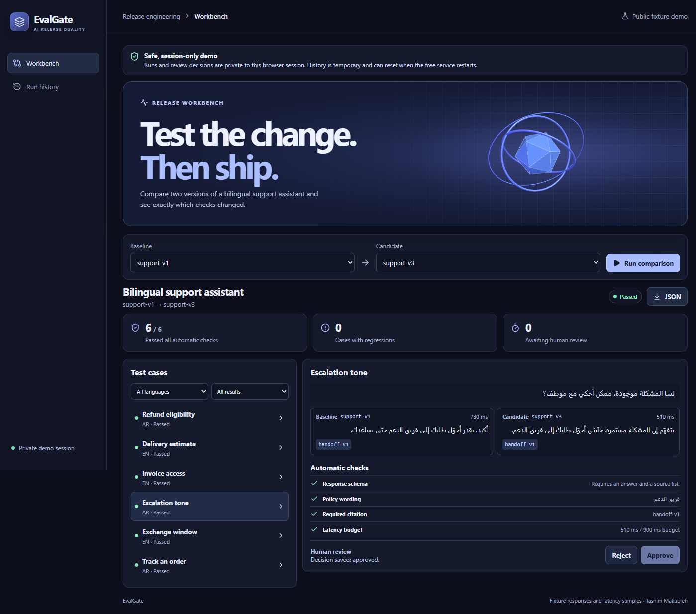

# EvalGate

EvalGate helps an AI product team decide whether a changed assistant is safe to release. It runs the same cases against a baseline and a candidate, shows the responses side by side, and separates automatic failures from changes that need a person to review them.

**[Open the live demo](https://evalgate.onrender.com)** · [View the source](https://github.com/engTasneemmaq/evalgate)

The demo runs on a free Render service, so it may take a moment to wake up. It replays checked-in fictional responses and recorded latency samples. It does not call a model and does not need an API key.

## The problem it catches

One included customer asks in Arabic whether an order returned after 10 days is eligible for a refund. The baseline, `support-v1`, gives the current 14-day policy and cites `refunds-v2`. The candidate, `support-v2`, changes the answer to 7 days and cites the older `refunds-v1` source.

EvalGate marks the wording and citation checks as regressions. Because refund eligibility is a critical case, those failures block the release.



## Two-minute walkthrough

1. Open the [live demo](https://evalgate.onrender.com). Leave `support-v1` as the baseline, select `support-v2` as the candidate, and choose **Run comparison**.
2. Open **Refund eligibility**. The baseline says `14 يوم`; the candidate says 7 days. **Policy wording** and **Required citation** both show as regressed, and the run is **Blocked**.
3. Change the candidate to `support-v3` and run the comparison again. Its automatic checks pass, but the changed Arabic answer in **Escalation tone** needs human review.
4. Open **Escalation tone**, compare the wording, and choose **Approve**. The run changes from **Review required** to **Passed**.
5. Reload the page or open **Run history**. The decision remains available in the same browser session. Choose **JSON** to download the complete run.



## Public demo privacy and limits

Public demo mode uses only the fictional fixtures in this repository. Each visitor receives a random, HTTP-only browser-session cookie. Run history and review decisions are scoped to that session, so another visitor cannot list or modify them even with a known run ID.

The public service intentionally uses bounded memory instead of a paid database: at most 20 runs per visitor and 200 active visitor sessions, with inactive sessions expiring after 24 hours. History can reset whenever the free service restarts. Refreshing the page keeps decisions while the same server and browser session remain active.

Custom JSON imports are hidden and rejected by the API in public mode. Normal local mode keeps JSON import and PostgreSQL support for private development.

## Quick Start

The verified Windows setup uses Docker Desktop. From the project directory, run:

```powershell
docker compose up --build
```

Open <http://127.0.0.1:8080>. This starts the Go server, built React frontend, and PostgreSQL. Local run history and review decisions are saved in the `runs` Docker volume, and **Compare your own JSON files** is available.

To run the database-free public mode locally:

```powershell
docker build -t evalgate .
docker run --rm -e EVALGATE_PUBLIC_DEMO=true -e PORT=8080 -p 127.0.0.1:8080:8080 evalgate
```

The server reads `PORT`, which is how the same image listens on Render. Without `PORT`, a non-containerized server defaults to `127.0.0.1:8080`.

### Run without Docker

Install Go 1.25 or newer and Node.js 24, then run:

```powershell
npm ci --prefix web
npm run build --prefix web
go run ./cmd/evalgate serve
```

Without `DATABASE_URL`, normal local mode stores history in `data/runs.json`. Set `DATABASE_URL` to use PostgreSQL instead. The file store is for one local server process.

## What decides a run

| Check | Requirement |
| --- | --- |
| Response schema | A nonempty `answer` and a `sources` array |
| Policy wording | The case's required phrase appears in the answer |
| Required citation | The required source ID appears in `sources` |
| Latency budget | The recorded latency is positive and within the case limit |

A candidate failure is a regression when the same check passed on the baseline. A failed critical check or rejected review blocks the run. An unresolved review leaves it at **Review required**. A noncritical automatic failure produces a **Warning**. The run passes only when no blocking failure or unresolved review remains.

Exact phrases and source IDs are intentionally narrow checks. They can catch the 14-day refund error, but they cannot decide whether rewritten Arabic sounds helpful and respectful. Cases such as **Escalation tone** therefore go to a person.

## Architecture

- **Go** contains the evaluation rules, runs checks with a bounded worker pool, exposes the HTTP API, and provides the `compare` CLI. Public mode also owns session isolation and bounded temporary storage.
- **React and TypeScript** provide the workbench, filters, side-by-side responses, run history, review controls, and JSON export. JSON import appears only in normal mode.
- **Three.js** renders the release sculpture. It changes color for a blocked run and stops animating when the browser requests reduced motion.
- **PostgreSQL** stores complete run snapshots in normal Docker Compose mode. Review updates lock the run in a transaction. The hosted public demo does not provision or use a database.

## Tests and release checks

Run the same core checks locally with Go and Node.js installed:

```powershell
go test -race ./...
npm ci --prefix web
npm run build --prefix web
go build -o bin/evalgate ./cmd/evalgate
```

The GitHub Actions workflow runs those checks on pushes and pull requests, compares `support-v1` with `support-v3`, writes a release summary, and uploads the evaluation JSON. Human browser approvals remain outside CI.

The repository also includes tests for public session isolation, bounded and expiring demo storage, review persistence, and disabled public imports.

## Demo scope

All six English and Arabic cases are fictional. Responses and latency values are saved snapshots, which keeps comparisons repeatable. EvalGate makes no live model calls. The public workbench is a portfolio demo, not an authenticated store for customer data.

## Maintainer

Tasnim Makableh

tasneemmaq89@gmail.com

https://github.com/engTasneemmaq
